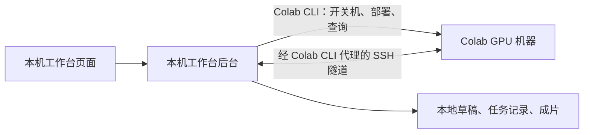

# Fieldwork · 本地 ComfyUI / Colab 工作台

一个可在本机使用的视频与语言模型工作台。提示词、工作流编辑、排队、记录和成片保存在本机；Colab G4 提供 GPU、模型部署、ComfyUI 执行和 LLM 推理。LLM 在本机提供按服务实例固定的 OpenAI 兼容端点。

默认使用已验证的 **MiniMax H3 INT8 ConvRot、普通 20 步、无 Turbo LoRA** 配置。项目调用用户自行配置的 `colab1` / `colab2` / … / `colabN` 启动器，支持一个或多个账号，账号登录凭证始终留在各自机器上。仓库中的这些名字是启动器槽位，不是 Google 账户信息。

## 架构与连接方式

本机负责编辑、调度和保存结果，Colab 负责运行 ComfyUI 与模型。工作台页面是轻量的自定义前端；工作流真正执行在云端。

| 部分 | 运行位置 | 职责 |
| --- | --- | --- |
| 工作台页面（React） | 本机浏览器 | 编辑提示词、参数和节点，预览作品与性能 |
| 工作台后台（FastAPI） | 本机 | 调用 CLI、管理账号和机器、排队、提交任务、取回成片 |
| Colab CLI + OpenSSH | 本机 | 使用所选账号管理 Colab 会话，并建立到该会话的连接通道 |
| ComfyUI + H3 + 性能采集器 | Colab GPU 机器 | 加载模型、执行工作流、生成视频、采集机器指标 |



**Colab CLI 和 SSH 分别做什么？** CLI 使用账号登录凭证申请或释放 GPU、查询会话和余额，并通过 `exec` 在云端执行部署脚本。OpenSSH 通过该账号的 `colabN ssh --proxy-mode` 代理连接到同一台 Colab GPU 机器，将云端 ComfyUI 的 `127.0.0.1:8188` 和性能采集器的 `127.0.0.1:8189` 映射到本机随机端口。工作台后台通过这些本地端口提交工作流、接收进度、下载成片和读取性能；「打开 ComfyUI」也使用同一条通道。无需另外准备一台 SSH 服务器。

**一次生成的过程：** 本机后台收到工作流 → 调用所选账号的 CLI 申请或复用 GPU → 部署 ComfyUI 和固定模型 → 建立 SSH 隧道 → 向云端 ComfyUI 提交工作流 → 下载视频和工作流到本地 → 按设置保留或释放机器。单纯切换账号只改变后续任务的目标，已有任务继续使用原账号。

**文件在哪里？** 草稿、任务记录、设置和已下载作品保存在本机 `.data/`；Colab 登录凭证由本机各账号启动器管理。模型和生成时的临时文件在 Colab 的 `/content`，释放机器后会被清除。提交任务时，提示词与工作流会发送到云端执行。账号凭证、SSH 私钥和本地运行数据均不包含在仓库中。

## 启动

先克隆仓库：

```bash
git clone https://github.com/0bCyan/colab-workbench.git
cd colab-workbench
```

前置条件：Python 3.12+、`uv`、Node.js 22+、OpenSSH，以及已登录的 Python 版 Colab CLI 0.8.0 多账号启动器。当前适配既有启动器约定：可执行文件位于 `PATH` 或 `~/.local/bin/colabN`，各槽位的凭证由启动器在 `~/.local/share/colab-accounts/credentials/N.json` 中维护。SSH bridge 会使用启动器 shebang 中的 Python；CLI 启动器及登录配置需要在本机单独准备，仓库不包含这些文件。没有账号也可以运行下面的自动化测试。

后台启动时自动发现上述目录中的账号入口和凭证文件名，按编号排序；编号可以不连续，也支持 `colab10` 等多位编号。仅配置一个账号时只显示该账号，数量不固定为三个。未安装入口或未登录的账号仍显示状态，但无法启动 GPU。新增入口后重新启动本地服务以发现账号；移除入口前应先释放它的机器。若本地记录仍关联云端会话，账号会继续显示，避免丢失机器管理入口。发现过程只查看文件名和是否存在，不读取凭证内容。

浏览器会记住所选账号；已记住的账号不存在时，优先选择已安装且已配置凭证的账号，再选择其他现有账号。没有账号时可继续编辑和浏览本地作品，启动 GPU 与生成按钮不可用。

macOS 双击项目中的 **`启动工作台.command`**，或在项目目录运行：

```bash
./scripts/start.sh
```

打开 `http://127.0.0.1:8765`。首次运行自动安装本地依赖并构建页面。脚本固定使用锁文件 `uv.lock` / `frontend/package-lock.json`。

正常退出请在启动窗口按 **Ctrl+C**。默认会释放工作台创建的机器。仅关闭浏览器页面不会停止本地后台；空闲关机仍由后台执行。

## 使用

1. 选择账号。初次选择会查询该账号的余额与会话，已有凭证不代表令牌一定有效；错误会显示在账号卡片。
2. 编辑提示词、尺寸、帧数、采样步数和 seed；或者切到「工作流」，拖动节点、编辑属性、连接端口。
3. 点击「生成视频」。工作台自动申请 G4、部署固定版本 ComfyUI、下载四个模型、建立本地 SSH 隧道并提交工作流。
4. 从任务进度查看部署、执行与结果取回。完成后，视频和当次 API 工作流一并保存到本地。
5. 可勾选「取回成片后关闭 GPU」，也可手动关闭；默认空闲 15 分钟自动关闭。

每次打开或刷新页面都新建创作：名称、描述和预览为空，尺寸、帧数、帧率、步数使用预设值，随机种子重新生成。打开空白页不会覆盖最近草稿。编辑后自动保存，旧内容可在「草稿」主动恢复，「另存」可保留副本。名称可留空，提交时按时间自动命名。分辨率提供横屏、竖屏、方形、快速预览选项，也可直接输入宽高；范围为 256–2048 px，须为 64 的倍数。导入/导出采用 **ComfyUI API JSON**，不是包含 `nodes` / `links` 的前端画布 JSON。节点布局保存在工作台草稿中，导出的 API 文件只包含执行图。

「添加节点」可复制当前工作流已有节点。完整的任意节点编辑请使用「打开 ComfyUI」，或导入其他 API 工作流。未安装的模型/自定义节点会由 ComfyUI 校验并返回错误；当前部署只包含下面的四个模型，禁用自定义节点。

账号切换仅改变新任务的目标：已经提交的任务继续绑定原账号。各账号各有机器、队列与日志；切走后仍在运行的工作台机器会在面板提示。账号的其他会话只显示存在情况，不提供停止入口。账户额度显示的是整个账号的消耗。

## 语言模型服务

侧栏「服务」专门管理 LLM，视频生成仍在「创作」。选择模型与部署账号，设置总上下文（32K / 128K / 256K，包含输入和输出），点击「创建实例」保存配置，或「创建并启动」立即部署。顶部下拉框用于切换已创建实例，「新建实例…」表示尚未保存的新实例配置。可填写「实例名称」，留空时按模型自动命名并编号；已有实例可用名称旁的「保存」重命名，运行中也能操作。自定义实例名独立于模型名称和 API `model` 字段，改名不改变端点、不重启机器。每个实例独立保存模型、账号、会话、隧道、端点、日志及性能数据。「连接测试」和「调用示例」右侧可修改「最大输出」（tokens，默认 4096），立即用于下一次测试请求并更新示例，无需重启服务。该值须小于总上下文；输入与输出共用上下文，输入占用后的实际可用长度由推理引擎校验。此项是调用参数，外部客户端仍可自行传入 `max_tokens`。运行期间锁定配置，更换模型或账号前先关闭该实例；已释放机器的实例可删除。

| 初始预设 | 引擎 | 权重量化 | 状态 |
| --- | --- | --- | --- |
| [Qwen3.8 27B](https://huggingface.co/Qwen/Qwen3.8-27B-FP8) | vLLM | FP8 | 待实机验收 |
| [Qwen3.8 27B RANA](https://huggingface.co/abliterant/Qwen3.8-27B-RANA-abliterated-FP8) | vLLM | FP8，减少拒答的社区版本 | 待实机验收 |
| [Qwen3.8 27B Huihui](https://huggingface.co/munekazu/Huihui-Qwen3.8-27B-abliterated-FP8) | vLLM | FP8，减少拒答的社区版本 | 待实机验收 |
| [Qwen3.8 Flash-Next GSQ-RCO](https://huggingface.co/ISTA-DASLab/Qwen3.8-Flash-Next-GSQ-RCO-GGUF) | llama.cpp | IQ3_S GGUF | 待实机验收 |

每个模型在 `templates/llm/<预设ID>.json` 中定义模型名称、权重 revision、量化方式、部署引擎和版本，`backend/llm_presets.py` 负责读取与校验。页面根据模型自动匹配框架，不再提供独立引擎选择。它们是用于后续验收的部署配方，不代表已在 G4 上通过加载、长上下文、质量或速度测试；界面不展示未经实测的速度。当前不接受任意仓库、远端代码或 shell 参数。vLLM 可设置显存预算，llama.cpp 可设置 CPU 线程数；当前都是单路生成。

**连接方式：** 本机调用方 → 本机 FastAPI 端点 → 该实例专属 SSH 隧道 → Colab 的 `127.0.0.1:8000` → vLLM / llama-server。远端环境在独立的 `/content/colab-workbench-llm` 中，首次启动才安装依赖并下载模型，不改 ComfyUI 的环境。模型仍保存在 Colab 临时磁盘，不上传到本机仓库。

每个实例的端点固定为 `http://127.0.0.1:8765/llm/<实例ID>/v1`，API 的 `model` 字段使用所选模型配置中的 `model_name`，通常为完整模型仓库名。例如启动 Qwen3.8 27B FP8 后，将下方示例中的 `svc-example` 换成实际实例 ID，并将复制的密钥设为环境变量：

```bash
curl http://127.0.0.1:8765/llm/svc-example/v1/chat/completions \
  -H "Authorization: Bearer $WORKBENCH_API_KEY" \
  -H 'Content-Type: application/json' \
  -d '{"model":"Qwen/Qwen3.8-27B-FP8","messages":[{"role":"user","content":"你好"}],"stream":true}'
```

OpenAI 兼容客户端填写该实例的完整 `/v1` 地址、工作台服务密钥和模型名即可。支持 `GET /models`、`POST /chat/completions`、`POST /completions` 及流式响应；暂不提供 embeddings、文件上传或云端管理接口。服务密钥是本地生成的应用密钥，与 Google 登录凭证无关。它保存在 `.data/`，只在用户点击复制或发送连接测试时取出，不进入常规状态响应、浏览器本地存储或日志。修改 Google 账号或切换页面账号不改变该密钥。

- 切换实例仅切换管理视图。已有客户端继续调用原实例的端点，关闭后返回 503，不会自动切到另一个实例或自动开机。模型名称与调用示例随所选模型更新，不使用统一的固定模型别名。
- 同一账号可以运行多个 LLM 实例，也可同时运行独立的视频机器。工作台不设“一账号一台”的限制；实际能申请多少台由 Colab 的额度、并发配额和当时资源决定。申请失败时显示错误；确认未分配机器后，可为该实例更换账号再试。存在其他会话不会阻止申请，也不会接管或停止这些会话。
- 每次分配先记录专属 `wbllm-<安装ID>-<账号编号>-<实例ID>-<随机ID>` 会话名，连接与停止时验证归属。重复启动复用当前操作；分配途中关闭会等待结果，再释放这台机器。失败仍保留关机入口。
- 单实例最多一个生成请求；额外请求返回 409。生成期间禁止关闭，空闲计时从请求结束开始。测试区的「停止生成」断开该请求，不释放机器。
- 不同实例可独立生成，即使它们使用相同账号与模型。关闭服务只释放该实例对应的 Colab 机器；重新打开本地工作台只显示等待重连，不自动重建或申请 GPU。「退出时释放机器」和空闲关机设置同时适用于视频与 LLM 服务。
- 升级旧版时，已有配置、日志和运行中的会话会迁移为独立实例，不自动重新部署。旧账号路径继续指向原实例；若旧会话仍使用原别名，会保留到手动关闭，下一次启动再使用模型自身名称。没有修改或启动过的默认账号槽位不生成空实例。
- 所有端点仍只监听本机。调用需 `Authorization: Bearer ...`；其他站点的浏览器请求被同源检查拒绝。需要保留本地后台运行才能调用。

## 作品管理与性能看板

- 「作品」支持按名称搜索、按账号/状态筛选、自适应分页、单个或批量选择、重命名、预览、下载和复用参数。复用参数前会自动为当前草稿保存副本。
- 「删除」先移入回收站，视频、工作流和任务记录仍在本地，可随时恢复。只有在回收站确认「永久删除」才删除所选任务的本地目录和记录；不会删除云端会话或账号凭证。
- 运行、准备、下载、等待恢复的任务必须先完成或取消，不能直接删除。批量操作会先验证全部所选记录；永久删除的文件权限错误按条目返回。
- 右侧性能看板显示 GPU、显存、CPU、RAM、磁盘、温度、功率和网络吞吐，约每 2 秒更新，最多保留最近 120 秒趋势。
- 监控采集器在 Colab 上用 `psutil` / `nvidia-smi` 只读采样，监听远端 `127.0.0.1:8189`，通过同一条 SSH 隧道转发。读取监控不会开机；关机、断线或账号切换后清除旧数值，缺失数据显示「—」。启动或重新连接机器时会部署采集器。
- 页面固定在一个视口内；窄窗口通过「预览与生成 / 创作参数 / 算力与性能」切换。提示词、节点属性和设置可在区域内滚动，页面与性能侧栏不滚动；性能指标随可用高度自动分列。

## 工作台设置

点击侧栏的设置按钮，或云端计算卡片里的空闲关机时间，打开小弹窗。弹窗覆盖在当前页面上，关闭后继续原来的编辑或作品浏览。账号切换立即生效，并启用「保存设置」供确认返回；仅切换账号时不会重新写入后台的连接或关机设置。空闲时间、退出时释放机器和 SSH 路径需要点击「保存设置」才生效。取消、右上角关闭、Esc 或点击弹窗外部会放弃未保存的参数修改，已经切换的账号会保留。保存失败时，错误和已填写的内容会留在弹窗内。单账号紧凑显示，多个账号自动排列；账号较多时在列表内滚动，保存按钮保持可见。

「高级连接」中保留 **SSH 私钥路径**：它指向本机的密钥文件，供上述 SSH 隧道连接 Colab 机器使用。它与 Colab 的 Google 账号登录凭证分别管理；改变这个路径不会切换 Google 账号。这是工作台共用的连接设置，各账号仍通过自己的 CLI 启动器访问各自会话。

首次初始化设置时，后台优先使用 `WORKBENCH_SSH_IDENTITY`，否则依次寻找本机 `~/.ssh/id_ed25519`、`~/.ssh/id_ecdsa`、`~/.ssh/id_rsa`。已有设置会继续沿用。若需要在弹窗修改，应填写可用的私钥文件完整绝对路径（不以 `~` 开头，也不要选择 `.pub` 公钥文件）；应用保存路径，OpenSSH 从本机读取私钥。连接已经正常时通常无需修改。保存新路径后，下次建立或重新建立隧道时使用，当前通道不会立即重建。

## 固定模型配置

| 项目 | 配置 |
| --- | --- |
| GPU | Colab G4 / RTX PRO 6000 Blackwell |
| ComfyUI commit | `4d64a8bc072b81c9b47321789b4d83fb7348ae2a` |
| 模型仓库 | `Comfy-Org/MiniMax-H3` |
| 模型 revision | `54472221d27c695fca9621b0c3ed52f06c4af707` |
| 主模型 | `diffusion_models/minimax_h3_fl2va_pruned_int8_convrot.safetensors` |
| 文本编码器 | `text_encoders/qwen3vl_32b_minimax_h3_nvfp4_awq.safetensors` |
| 视频 VAE | `vae/minimax_h3_video_vae_int8_convrot.safetensors` |
| 音频 VAE | `vae/minimax_h3_audio_vae_fp32.safetensors` |
| 参数 | 1344 × 768，124 帧，24 fps，20 步 |
| 采样 | `res_multistep` / `simple`，video/audio shift 12/3 |
| 加速 LoRA | 无 |

部署检查 Blackwell 和 CUDA 13；不满足要求时停止部署并保留明确的关机入口。模型合计约 40 GB，每台新机器都要重新下载。释放 Colab 会话会清除远端 `/content`；本地视频、草稿和任务记录保留。当前未配置 Drive 或其他持久云盘缓存。

仓库仅提供程序生成的测试视频 `tests/fixtures/synthetic.mp4`，不包含真实作品、截图或账号数据。新打开的工作台显示空白预览；历史成片保存在本机，可从「作品」主动预览。

## 任务与机器生命周期

- 单个账号串行提交到 ComfyUI，不同账号可独立运行。每账号最多 20 个本地待处理任务。
- 每次创建机器先记录归属和会话名，`wb-<安装ID>-<账号>-<随机ID>`。关机检查该归属，释放后向 Colab 再查会话确认。
- 重复点击启动复用正在进行的操作。申请过程中点击关闭，会等申请返回，再释放这次创建的机器。
- 使用 caller-generated UUID，并在向 `/prompt` 提交前落盘。网络中断后查询原 ID 的 history/queue；不会自动重新提交不确定的任务。
- 取消使用 ComfyUI 的单任务取消接口。不会全局中断其他任务。下载结果期间不允许取消，防止已生成的成片丢失。
- 「完成后关机」等到成片下载完成且本地队列已空，再检查 ComfyUI 是否还有直接从原生编辑器提交的任务。
- 正常退出服务按设置释放自己的机器；后台被强制杀死、电脑休眠/断电或失去网络时，自动关机无法保证执行。重新打开后显示断线状态，可以重连恢复查询或直接关机。
- SSH 代理禁止隐式创建会话。重连失效机器不会偷偷申请 CPU 或新的付费 GPU。
- 隧道、ComfyUI 和本地服务都监听 `127.0.0.1`。本地写接口检查 Origin、Host 和会话 token，不把 Google 凭证传给浏览器或云端。

**原生 ComfyUI 编辑器的边界：** 它通过本地隧道打开，计算仍在 Colab。从原生编辑器直接提交的任务不进入本工作台的本地归档；需要自行下载。若希望自动归档和完成后关机，导出 API 工作流后从本工作台提交。工作台的空闲检查会看到原生编辑器队列，不会把正在计算的机器判为空闲。

## 文件结构

```text
backend/
  app.py            本地 HTTP API、同源防护、静态页面
  manager.py        账号隔离、部署、任务队列、恢复、关闭机器
  llm.py            独立 LLM 会话、配置、健康检查、单路请求与释放
  llm_presets.py    固定版本的模型与引擎预设
  deploy_llm_remote.py  独立 vLLM / llama.cpp 安装、下载与服务启动
  colab.py          调用现有 Colab CLI，建立受控 SSH 隧道
  bridge.py         保留多账号上下文、禁用 SSH 隐式开机
  deploy_remote.py  固定版本远端安装与下载
  store.py          SQLite 本地持久化
  library.py        作品重命名、回收站、恢复与本地文件删除
  telemetry.py      账号/会话隔离的性能采样缓存
  telemetry_remote.py  远端只读性能采集器
frontend/           React + TypeScript + React Flow
templates/          已验证 H3 API 工作流；llm/ 内为逐模型 JSON 配置
tests/              后端集成测试、模拟器与合成视频素材
frontend/tests/     Playwright 浏览器端到端测试
.data/
  workbench.sqlite3 草稿、机器归属、任务、设置、日志
  outputs/<任务ID>/  视频及 workflow-api.json
```

`.data/` 是本地运行数据，不应提交进 Git。**机器运行期间不要删除或移动 `.data/`**，它包含机器归属和关机所需的会话名。完成关机后可备份整个 `.data/`。项目没有凭证导出功能。

开发模式：

```bash
uv sync --frozen
uv run uvicorn backend.app:app --host 127.0.0.1 --port 8765
# 另一个终端
npm --prefix frontend ci
npm --prefix frontend run dev
```

后端默认 8765，Vite 默认 5173。可通过 `WORKBENCH_DATA` 改运行数据目录，通过 `WORKBENCH_SSH_IDENTITY` 设置首次启动时的私钥默认路径；之后从页面设置修改。当前适配 macOS / Linux 的托管 Python 版 Colab CLI 0.8.0 多账号入口。

## 验证

```bash
uv run pytest -q
uv run ruff check backend tests scripts
npm --prefix frontend run build
npm --prefix frontend run test:e2e
```

自动化测试使用独立临时数据库和本地 HTTP/WebSocket 模拟器，不会创建付费机器。本地浏览器测试使用 Chrome；GitHub Actions 使用 Playwright Chromium。

`scripts/real_smoke.py` 是需显式运行的实机验收脚本，必须通过 `--account` 指定一个空闲账号；它会申请付费 G4，完成生成、下载和释放，不属于日常自动测试或 CI。

```bash
# 先启动本地工作台；确认你确实要进行一次实机验收
uv run python -m scripts.real_smoke --account colab1
```

验证记录见 `VALIDATION.md`。


## 仓库维护

```bash
# 每个新克隆设置一次；提交时检查 Git 暂存区中的实际内容
git config core.hooksPath .githooks
python3 scripts/check_publish.py
```

提交检查和 CI 会拒绝运行数据库、备份、截图、凭证/会话导出、私钥、已知令牌格式、真实工作台会话 ID 和个人主目录路径。检查只输出文件和问题类别，不回显敏感值。规则不能替代提交前查看差异；本地账号、会话、日志、作品和 `.env` 等均在 `.gitignore` 中排除。

GitHub Actions 运行提交检查、Ruff、后端测试、前端构建和浏览器端到端测试。测试使用临时目录与模拟器，不需要 GitHub Secrets 或 Colab 登录，不申请 GPU。实机验收原始记录保存在本地，`VALIDATION.md` 仅保留去标识后的验证说明。

## 许可证

项目代码和合成测试素材按 [MIT License](LICENSE) 开源。ComfyUI、Colab CLI 与下载的模型由各自许可证约束；本仓库不分发模型权重或第三方登录凭证。
