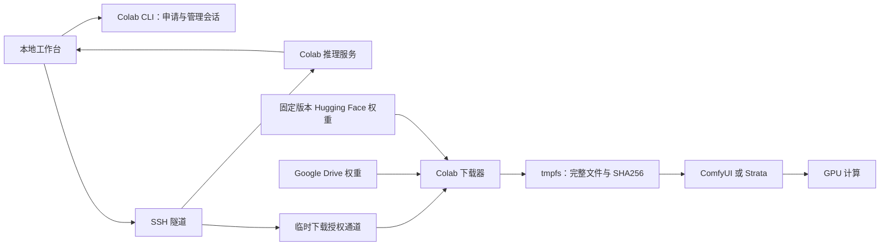

# Colab 模型下载与加载：方案、实测及复用指南

更新日期：2026-11-13（Asia/Shanghai）。适用项目：Fieldwork／colab-workbench。

本文记录当前已实现的路线与已有实测，不包含账号、云盘文件 ID、登录凭证、会话或服务密钥。代码行为以本文列出的源码为准，历史性能结果来自 [VALIDATION.md](../VALIDATION.md)；耗时不保证每次相同。

## 1. 当前采用的方案

本地负责编辑工作流、管理实例与授权、展示进度和保存作品；Colab 负责下载、安装环境、加载模型和计算。大模型文件由 Google Drive 或 Hugging Face **直接下载到 Colab 的 tmpfs 内存文件系统**，不经过本机中转，也不先在 Colab 普通磁盘保存一份完整模型。

下载与环境安装尽量并行，完整文件经过 SHA256 校验后才作为可用权重提交。推理进程随后读取这些文件，并按引擎策略使用 CPU 内存及 GPU 显存。

目前没有实现“尚未下载完成就让模型开始推理”。已经实现的是：

- 网络分块并发下载，按文件顺序写入内存文件系统，边写边计算完整 SHA256。
- 下载剩余权重时并行安装环境；LLM 先恢复小型引擎包，再安装其 Python 依赖。
- 同一台机器复用完整且校验过的文件，省去重复下载。

不将整个 Python 环境冻结成云盘镜像。媒体包只保存权重；现有 LLM 包例外，还带有固定引擎、启动脚本、Tokenizer 等支持文件，Python 环境仍在云端建立。

## 2. 数据与控制分别走哪里



图中普通箭头表示调用或数据方向，不表示模型字节经由授权通道传输。

| 内容 | 保存或运行位置 | 说明 |
| --- | --- | --- |
| 页面、工作流、实例配置、任务数据库、成片 | 本地 | 本机无需保存完整模型 |
| 模型权重 | Drive／Hugging Face | 长期保存及冷启动下载源 |
| 私有 Drive 索引 | 本地 `.data/cloud/` | 文件 ID、大小、目标路径及 SHA256；不发布 |
| ComfyUI、Python 依赖与日志 | Colab 普通文件系统 | 运行时安装，随临时机器释放而失去 |
| 媒体权重 | Colab `/content/colab-workbench/weights` | tmpfs，ComfyUI 模型目录通过符号链接引用 |
| LLM 权重与支持文件 | Colab `/content/colab-workbench-llm/model` | 独立 tmpfs，包含固定引擎支持文件 |
| 实际运算与推理缓存 | GPU 显存、CPU 内存 | 容量和放置由框架决定 |

SSH 负责本地访问服务端口、读取监控，以及将本地临时授权服务反向映射到 Colab。模型数据由 Colab 的 HTTPS 连接直接读取 Drive／Hugging Face，模型下载速度不取决于本机下载带宽。

Drive 使用独立的 `drive.readonly` 授权。本地保留刷新凭证，通过 SSH 提供短时访问令牌及当前实例所需的索引。短时令牌仍是读取授权；不等同于只对一个文件有效的签名 URL。Colab CLI 登录和 Drive 授权是两套配置。

## 3. 当前四条加载配置

GB 为十进制，GiB 为二进制；下表为完整下载清单大小，不是显存需求。

| 配置 | 权重精度 | 下载源 | 清单总大小 | 验证程度 |
| --- | --- | --- | ---: | --- |
| Flash-Next Uncensored／Strata MTP4 | 专家 NVFP4、dense Q8_0、完整 PLE FP8 | 私有 Drive | 128.265 GB／119.456 GiB，7 文件 | 全量恢复及真实推理通过 |
| MiniMax H3 Video | DiT INT8 ConvRot、编码器 NVFP4 AWQ、视频 VAE INT8、音频 VAE FP32 | 私有 Drive | 40.074 GB／37.322 GiB，4 文件 | 视频及音频生成通过 |
| MiniMax H3 Image／INT8 | DiT INT8 ConvRot、编码器 NVFP4 AWQ、图像 VAE FP16 | 私有 Drive | 37.835 GB／35.237 GiB，3 文件 | 2048×2048、6 步真实生成通过 |
| MiniMax H3 Image／BF16 | DiT BF16、编码器 BF16、图像 VAE 仍为 FP16 | 固定 revision 的 Hugging Face | 92.909 GB／86.529 GiB，3 文件 | 配置、分段链接及模拟部署通过，未实机出图 |

BF16 使用 Comfy-Org 的 ComfyUI 封装和裁剪文件，不能称为 MiniMaxAI 原始 Diffusers 文件的逐字节镜像；也不是全部组件都为 BF16。当前没有把 BF16 三文件上传到私有 Drive。

INT8 图片和视频共享同一编码器，在同 VM 切换时可复用。BF16 编码器为另一文件，需要额外下载。LLM 实例与创作实例分别管理，不能将两者都装入单台 G4 的能力视为已验证。

## 4. 冷启动的具体顺序

### LLM：先恢复支持文件，再重叠安装与下载

1. 本地检查配方、私有索引、Drive 只读授权和 SSH 配置。
2. 用所选账号申请独立 G4，记录实例归属并建立 SSH 通道。
3. 远端检查 Blackwell／CUDA 和可用 RAM；当前要求至少 **155 GiB 可用内存**。
4. 在模型目录挂载容量上限 **145 GiB** 的 tmpfs。该值是上限，不会立即预占 145 GiB。
5. 下载器先恢复并校验小型支持归档，解压后写入运行文件就绪标记。
6. 环境线程检测到标记后执行依赖安装；下载线程继续恢复大文件。两条线程都完成后才进入服务加载。
7. 核对包中的模型版本，写入本实例的上下文、CPU 线程及缓存配置。
8. Strata 以 `mmap-experts` 读取完整 PLE 及其他模型文件，加载必要 GPU 数据并启动服务。
9. 检查 `/v1/models` 返回预期模型后，本地端点才标记为就绪。

这里的 mmap 映射来自 tmpfs 中已经完整存在的文件，不是每个 token 从云盘临时取专家，也不是绕过物理内存容量限制的“无限内存”。

### H3：权重恢复和 ComfyUI 安装同时开始

1. 本地依据工作流识别图片／视频及精度，准备对应权重清单。
2. 申请或复用创作 VM；任务运行中不切换部署。
3. 下载线程恢复所选权重，环境线程拉取固定 ComfyUI commit、建立 venv 并安装 requirements。
4. 两者完成后，将 ComfyUI 的模型文件路径链接到 tmpfs 权重。
5. 启动 ComfyUI，检查 `/system_stats`。初始化阶段、环境状态和下载计数由采集器与性能指标在同一次 `/metrics` 响应中返回，前端一起更新，约每秒刷新。
6. 提交工作流；ComfyUI 首次执行加载节点时才真正加载对应权重并生成。
7. 本地接收进度，生成完成后取回 PNG／视频及工作流，可按任务设置释放机器。

**ComfyUI 已就绪不表示所有权重已经驻留显存。** 首次任务包含实际加载开销，后续任务可能复用模型。LLM 的就绪检查则发生在模型服务启动后，两者耗时不能直接按同一含义比较。

媒体 tmpfs 当前默认上限为 **80 GiB**，BF16 路线扩至 **128 GiB**。下载前检查缺失文件大小及至少 30 GiB 的可用内存余量；这是预检查，不保证所有分辨率和模型组合都能推理。叠加图片、视频、BF16 后会继续占用 RAM，不能只看单个包的大小。

## 5. 下载器怎么省磁盘并保证完整性

默认 64 路下载，默认单块 64 MiB，生产实现将 `并行数 × 分块大小` 限制在 **4 GiB** 的在途块负载内。LLM 可以配置 1–256 路，媒体当前固定 64 路。

同一时刻并行读取当前文件的多个 Range，按照文件偏移顺序写入 `.stream-part`。文件之间按既定顺序逐个恢复；不是一次同时下载所有权重文件。写入过程中持续更新 SHA256，完整大小及哈希都匹配后才原子改名为正式文件。

写入 `.stream-part` 的位置也在 tmpfs，因此没有“模型先落 SSD 再搬到 RAM”的第二份完整副本。下载用的缓冲块只是附加占用。

需要区分三个上限：

- 4 GiB 是在途分块负载上限，不是 Python 进程总 RSS 上限。
- tmpfs 内的完整权重本身消耗 RAM。
- 推理加载、CPU 张量、GPU 拷贝、KV Cache、工作区和系统服务还需要额外空间。

当前失败恢复是**完整文件复用**，不是任意字节的断点续传。若文件大小及修改时间与之前的校验标记一致，会在同 VM 上跳过下载；半下载文件重试会重新开始。已有标记复用也不等于每次重新读取完整文件计算 SHA256。

BF16 的公开下载复用同一下载器：清单固定 Hugging Face revision、文件字节数及 LFS SHA256，无需 Drive 令牌。目前仅核对了三个真实 URL 的 1 KiB Range 响应，完整下载及 G4 推理仍待验证。

## 6. 为什么没有打包整个环境

当前保留“固定版本说明＋运行时安装”的做法：

- ComfyUI 固定 commit；模型来源固定 revision 和文件摘要。
- 媒体包不包含 venv、系统 CUDA 或 Python 全量环境。
- LLM 包保存已验证的引擎和必要脚本，启动时仍安装 Python 依赖。
- 安装环境与权重下载重叠，减少二者相加的等待时间。

并行启动的近似关系为：

`总时间 ≈ 开机与连接 + max(权重下载校验, 环境安装) + 模型加载 + 健康检查`

LLM 的依赖安装要等待小型支持归档，无法从第 0 秒完全并行。若网络或依赖服务变慢，安装仍可能成为瓶颈。固定 ComfyUI commit 也不等于基础 Colab 镜像及全部传递依赖永不变化。

## 7. 已有实测结果

主要测试硬件为 Colab G4 STANDARD／RTX PRO 6000 Blackwell，约 96 GiB 显存、177 GiB 系统 RAM；测试机实际 CPU 规格和可用资源以当次检测为准。

### 下载并行数探索

每档两轮，读取相同 **8 GiB** 区间，32 MiB 固定分块、顺序 SHA256；全部零 HTTP 错误、零重试。

| 并行数 | 两轮平均吞吐（MB/s） | 进程采样峰值 RSS（GiB） |
| ---: | ---: | ---: |
| 64 | 432.0 | 2.02 |
| 96 | 451.3 | 2.99 |
| 128 | 427.3 | 4.04 |
| 192 | 413.0 | 5.96 |
| 256 | 283.5 | 8.04 |

这组探索使用固定 32 MiB 分块，所以高并发档的缓冲随并行数增长；生产实现已改为总分块负载封顶。表格不是每档完整模型恢复结果，也没有找到绝对稳定极限。

96 路仅略快于 64 路，256 路明显更慢。当前默认继续采用经过完整恢复验证的 64 路，不以请求数最大为目标。

### 完整恢复与启动

| 项目 | 记录 | 计时边界与限制 |
| --- | --- | --- |
| LLM 全量文件恢复 | 119.456 GiB，约 177.7 秒 | 七文件完整 SHA256；不是含开机的端到端时间 |
| LLM 冷启动 | 历史记录约 256–274 秒 | 不同轮次和起止点，未形成统一多轮基准 |
| H3 共享媒体环境 | 历史约 157 秒准备完成 | 小尺寸链路验证，不能当作默认视频生成耗时 |
| H3 Image INT8 冷启动到任务提交 | 约 131.9 秒 | 包含开机、部署、下载和连接 |
| H3 Image INT8 生成并归档 | 约 16.8 秒 | 2048×2048、6 步，一张图；含首次模型加载及结果传回 |
| H3 Image INT8 全流程 | 约 148.8 秒 | 同一个样本，从创建任务到本地完成 |
| H3 Image BF16 | 暂无 G4 全流程结果 | 仅链接及自动化验证 |

不能把下载吞吐、首字时间、decode 速度或整张图生成时间混为一谈。4 MP 图的结果不能外推为 16 MP 图的耗时或显存。

### CPU 与推理并发的补充结论

下载并行数、CPU 线程数、同时推理请求数是三个独立设置。

CPU 8／12／16／24／48 线程下，当前 LLM 短输入 decode 约 286–289 token/s，128K 续聊约 250 token/s，没有观察到可归因于增线程的明显收益，保留 CPU12 默认。

短输入并发实测：1 路每路约 284 token/s；2 路约 136–140；4 路约 76–83。四路总完成吞吐约 297 token/s，收益有限；45K 冷输入四路首字最长约 44 秒。此测试直接访问引擎，**工作台生产入口仍保留单请求保护**，并未启用四路服务，也没有验证四路 128K／256K。

## 8. 缓存、重连和机器释放

| 情况 | 当前行为 |
| --- | --- |
| 同 VM 重复加载相同文件 | 复用完整校验标记；不重复下载 |
| ComfyUI 同 VM 切换图片／视频 | 下载缺失文件、保留已有权重及共享编码器；已有进程继续运行 |
| 切换 BF16 | 额外下载 BF16 主模型及编码器，重新评估剩余 RAM |
| LLM 前缀与会话缓存 | 属于推理缓存，和权重下载缓存无关 |
| 本地服务断线 | 云端模型不一定停止；先核对原实例和端点 |
| CLI 状态读取暂时超时 | LLM 对原实例进行有限重试，避免一次超时误报终止 |
| 本地工作台重启 | 不自动恢复部署或申请 GPU；保留仍有归属的记录，等待重新连接 |
| 关闭／释放 Colab VM | tmpfs、依赖、运行日志及推理缓存失去，下次重新恢复 |

本地退出是否释放机器由 `stop_on_exit` 决定，空闲释放由 `idle_minutes` 决定。更新本地代码不能假设只会刷新页面；需要留意退出策略、活动请求及实例归属。仅停止已知属于本工作台的实例，不按账号批量接管外部会话。

## 9. 复刻到另一台机器所需的内容

代码可以复刻下载与加载流程，但代码仓库本身不包含运行授权。另一台控制机需要：

1. 项目源码、`uv`、Node.js、SSH 以及相应版本的 Colab CLI 多账号启动器。
2. 有效且由用户管理的 Colab 账号凭证、可用的 SSH 私钥与连接设置。
3. 对于 Drive 路线：独立只读 Drive 授权、rclone、对应私有索引，以及读取源文件的权限。
4. 对于 BF16 公开路线：固定的公开清单及可从 Colab 访问源站的网络。
5. 在目标端验证账号枚举、读权限和索引，再主动启动一个新实例测试；不复制旧会话记录冒充新机器已连接。

私有索引导入示例：

```sh
uv run python scripts/import_bundle.py /path/to/orca-flash-next-nvfp4-strata-mtp-g4-v1.json
uv run python scripts/import_bundle.py /path/to/h3-image-g4-v1.json
uv run python scripts/import_bundle.py /path/to/h3-video-g4-v1.json
```

本轮探索不保证迁移凭证后永远无需重新登录。账号、Drive 和 SSH 是不同授权来源，应分别检查；公开发布源码时不能连同 `.data/`、凭证、私钥或真实会话上传。

## 10. 相关实现入口与后续验证

| 文件 | 职责 |
| --- | --- |
| [backend/bundles.py](../backend/bundles.py) | 私有清单校验、只读令牌刷新、按实例授予临时索引访问 |
| [backend/bundle_restore_remote.py](../backend/bundle_restore_remote.py) | Range 并发、缓冲上限、顺序写入与 SHA256、完整文件复用 |
| [backend/deploy_llm_remote.py](../backend/deploy_llm_remote.py) | LLM tmpfs、并行安装、部署阶段与模型健康检查 |
| [backend/llm_serve_remote.py](../backend/llm_serve_remote.py) | 仓库维护的 Strata 启动入口 |
| [backend/deploy_remote.py](../backend/deploy_remote.py) | 媒体权重、ComfyUI 安装与启动、BF16 公开下载 |
| [backend/manager.py](../backend/manager.py) | 创作任务、VM 复用、模型切换及归档 |
| [backend/llm.py](../backend/llm.py) | LLM 实例、原会话重连、端点与请求保护 |
| [backend/colab.py](../backend/colab.py) | CLI 管理及 SSH 正反向转发 |
| [templates/h3-image-bf16-weights.json](../templates/h3-image-bf16-weights.json) | BF16 公开文件、固定 revision 和摘要 |
| [VALIDATION.md](../VALIDATION.md) | 各阶段验证记录 |

后续最值得补的验证是 BF16 全量恢复与 4／16 MP 真实生成、统一计时边界的多轮冷启动、图片／视频／BF16 连续切换的 RAM 余量。若进一步测试下载并行数，应使用生产缓冲限制和完整文件校验，不重复用固定分块样本推断稳定极限。
